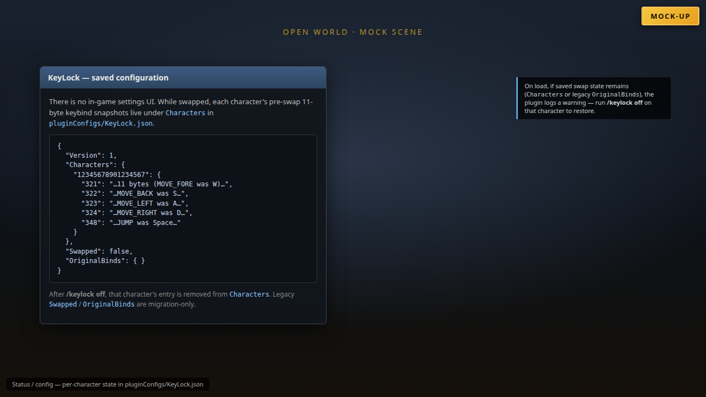
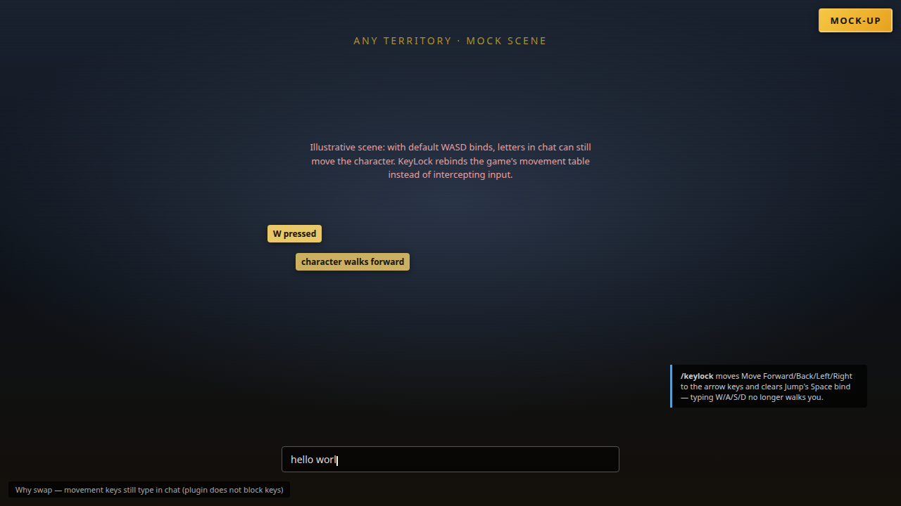
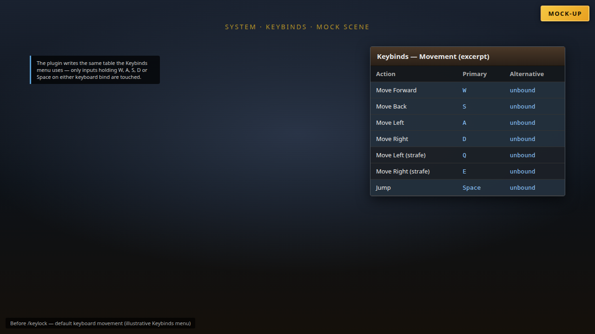
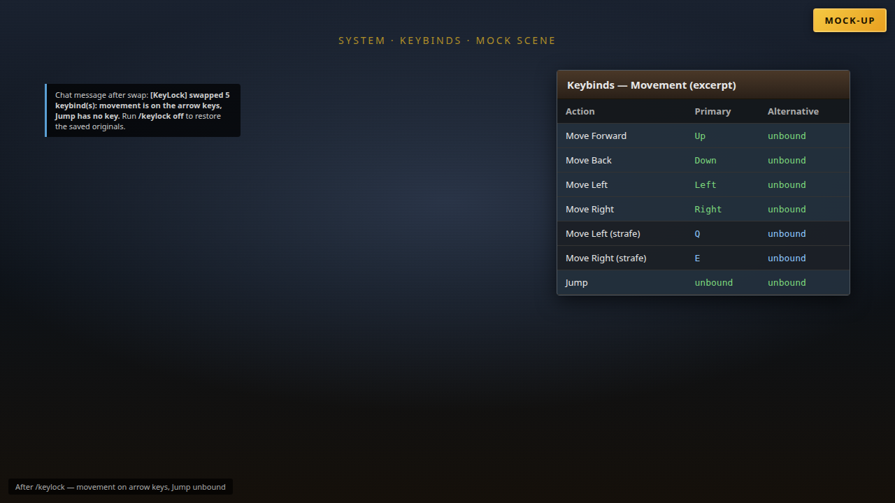
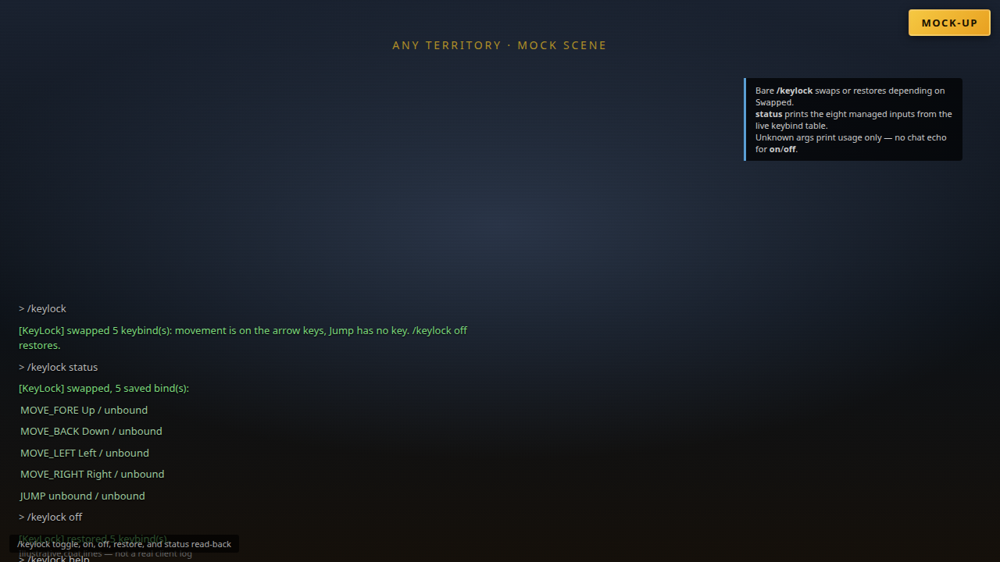

# KeyLock


Moves FFXIV's movement keys off WASD and jump off Space with one command, and puts them back exactly as
they were — so typing in chat can never walk you into a wall.

`/keylock` · Dalamud API 15 · .NET 10

## Screenshots

These images are **mock-ups** (HTML rendered to PNG). They are not real in-game captures and do not show the actual FFXIV client UI.

| | |
| --- | --- |
|  | **Saved configuration** — no settings window; `Swapped` and saved original keybind bytes live in `pluginConfigs/KeyLock.json`. |
|  | **Why swap** — with default WASD binds, typing those letters in chat can still move the character (the plugin rebinds the table; it does not block keys). |
|  | **Before `/keylock`** — illustrative Keybinds excerpt with W/A/S/D and Space on movement and Jump. |
|  | **After `/keylock`** — movement on arrow keys, Jump unbound; Q/E strafes unchanged. |
|  | **Commands** — toggle swap/restore, `/keylock status` read-back for the eight managed inputs, usage text for unknown args. |

## Mock-up video

A short **mock-up** walkthrough (not real gameplay) cross-fades through the same scenes with on-screen captions. The gold **Mock-up** label stays visible for the whole clip.

- [mockup-walkthrough.mp4](docs/videos/mockup-walkthrough.mp4) (H.264, 1280×720, ~18 s)
- [mockup-walkthrough.gif](docs/videos/mockup-walkthrough.gif) (preview)

## What it does

- **One command swaps the movement binds.** Move Forward/Back/Left/Right and both strafes go to the
  arrow keys (W→Up, S→Down, A→Left, D→Right) and Jump loses its Space bind. It writes the game's own
  keybind table, so the Keybinds menu shows the change and nothing about it is hidden.
- **The same command puts them back,** including each input's alternative keyboard bind. Only inputs
  actually holding W, A, S, D or Space are touched.
- **The originals are saved before the write,** in the plugin configuration, so `/keylock off` still
  restores them after the client has been restarted.
- **`/keylock status` reads the live binds back** for the eight inputs it manages, plus the saved
  count — that read-back is how you confirm a write landed.

### What it is not meant to do

- **It does not block, swallow or freeze keys.** While swapped you still move, on the arrow keys;
  nothing is intercepted, nothing is faked, no input is sent.
- **It does not touch anything outside the movement and jump inputs.** Hotbar keys, camera keys, Q/E
  strafes, modifiers, gamepad binds and every other keybind stay as they are.
- **It does not restore itself on unload.** Disabling the plugin while swapped leaves the binds
  swapped; `/keylock off`, or the Keybinds menu, is the way back.
- **It does not act on its own.** No trigger, no timer, no reaction to chat: you run the command.

## How it works

The keybind table lives in the game's `InputData` object (`UIInputData.Instance()`). `GetKeybind(InputId)`
returns the 11-byte `Keybind`: two keyboard `KeySetting`s (primary and alternative), two gamepad
settings, three spare bytes. The plugin copies that struct, remaps only the two keyboard key bytes (a
key moved to "no key" also drops its modifier) and hands the copy to `SetKeybind` — the same virtual function the Keybinds menu's Apply uses, so the game
refreshes its own state and UI. Inputs covered: `MOVE_FORE` 321, `MOVE_BACK` 322, `MOVE_LEFT` 323,
`MOVE_RIGHT` 324, `MOVE_STRIFE_L` 325, `MOVE_STRIFE_R` 326, `MOVE_AND_STEER` 327 and `JUMP` 348.

Because it is a table write and not input interception, there is no per-frame work and no hook or
signature of this plugin's own to break on a game patch. A layout guard refuses to write if
`sizeof(Keybind)` ever stops being 11.

## Install

Add this custom plugin repository in Dalamud's plugin installer:

```
https://raw.githubusercontent.com/priestkos/PlogonYes/main/pluginmaster.json
```

Then install **KeyLock** from the list and enable it in `/xlplugins`.

## Building

Requires the .NET 10 SDK and the Dalamud dev distribution
(`%APPDATA%\XIVLauncher\addon\Hooks\dev`, or `DALAMUD_HOME`).

```
dotnet build KeyLock.csproj -c Debug      # load bin/Debug/KeyLock.dll as a dev plugin
dotnet build KeyLock.csproj -c Release    # zip in bin/Release/KeyLock/latest.zip
```

## Releases

Pushes to `main` that change the plugin (not docs-only paths ignored by the release workflow) cut a
GitHub release automatically. The version is the next four-part number above the latest release tag, or
the csproj version when that is higher.

## Commands

| Command | Effect |
| --- | --- |
| `/keylock` | swap the binds, or restore them if they are already swapped |
| `/keylock on` | swap |
| `/keylock off` | restore the saved binds |
| `/keylock restore` | same as `off` |
| `/keylock status` | print the eight managed binds and the saved count |

## Settings

No window and no settings page. The plugin's entire state is the Dalamud config file
`pluginConfigs/KeyLock.json`: per character (keybinds are per character), whether the binds are
currently swapped and the saved originals. `/keylock off` writes a bind back only while it still holds
what the swap wrote, and only its keyboard bytes; a bind changed since then is left alone and named.

## Install (dev plugin)

1. `/xlsettings` → Experimental → Dev Plugin Locations → add `bin\Debug\KeyLock.dll`.
2. `/xlplugins` → Dev Tools → enable **KeyLock**.
3. `/keylock` swaps and restores; `/keylock status` shows the live binds.

## Tests

53 offline checks over the mapping decision: every remap, that remapping is idempotent, that Q/E,
Enter, NumPad0 and F1 are left alone, that a default keyboard loadout changes exactly five inputs, and
that no two movement inputs land on the same arrow; and over the swap/restore state: per-character
isolation, no second swap while swapped, restore skipping a bind changed after the swap, gamepad bytes
kept, modifier cleared with Space, and adopting a pre-per-character snapshot only on a matching
character. No Dalamud, no dev distribution, no game.

```
dotnet run --project tests/KeyLock.Tests.csproj -c Release    # 53/53 checks passed
```

## Limits

- **Not verified in a live client.** The byte layout, the input ids and the key codes were checked
  against the shipped `FFXIVClientStructs` (`sizeof(Keybind)` 11, both offsets, all eight ids, all key
  codes), but movement after a swap was not observed by the author. `/keylock status` confirms the
  write; the walk test is yours.
- Whether the game persists the swapped binds to its own config files is not established. The saved
  snapshot is what makes a restore work either way.
- An unclean exit while swapped (crash, force close) leaves arrow-key movement until `/keylock restore`
  runs or the binds are set by hand.
- Removing the plugin while swapped deletes its saved originals with it: the binds stay swapped and
  must be set back by hand in Keybinds. Run `/keylock off` on each swapped character first.
- Space stops jumping entirely while swapped — that is the second half of the swap.
- Only W/A/S/D/Space are moved. If movement already sits on other keys there is nothing to swap and the
  command says so. Mouse-drag movement, autorun and controller movement are unaffected.

## Layout

```
KeyLock.csproj   manifest properties, Dalamud.NET.Sdk/15.0.0
Plugin.cs        command handling, the keybind swap and restore, status read-back
KeyMap.cs        the whole decision: which key becomes which, pure and Dalamud-free
Configuration.cs per-character swap state and saved originals
tests/           offline harness over KeyMap.cs
.github/         build (artifact + offline checks) and release workflows
docs/            mock-up screenshots and walkthrough video (not real captures)
images/          plugin icon
```
